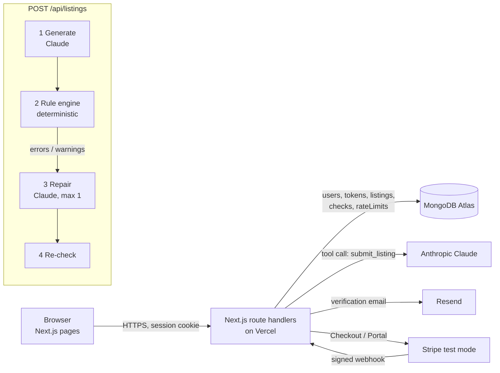

# ListLocal

**Cross-border listing localization + compliance assistant for Amazon US.**
Chinese sellers type product info in Chinese (optionally with photos). ListLocal writes a US-style Amazon listing — title, five bullets, description, backend search terms — then runs a deterministic rule engine over it, auto-repairs what it can, and shows every remaining risk with the public source it is based on.

> Capstone project. The compliance rules are compiled from public material and are not legal advice; always confirm against the current Amazon Seller Central policy before listing.

## Why not just use ChatGPT?

| | ListLocal | General chat AI |
|---|---|---|
| Compliance | Same deterministic rules every time; each issue cites a source | Depends on the model remembering; no sources |
| Invented specs | Every number in the output is checked against the seller's input (unit conversions allowed) | Often "fills in" plausible specs |
| Limits | Characters and UTF-8 bytes counted by code | LLMs miscount characters |
| Workflow | Draft → check → repair → re-check, all saved in history | One-off chat |

## Features

- Email + password sign-up with **email verification** (Resend), session cookie (HS256 JWT, httpOnly)
- **Generate**: Chinese input + up to 3 images → Claude writes the listing through a typed tool call
- **Rule engine** (`src/lib/compliance/`): medical/disease claims, antimicrobial (pesticide) claims, unqualified environmental claims, guarantees, promotional words, third-party brands, contact info, untranslated text, title length / forbidden characters / word repetition, bullet rules, 250-byte search terms, invented numbers
- **Auto-repair loop**: rule hits are sent back to the model once; the result is re-checked; whatever remains is shown honestly
- **Check existing listing**: rule engine only, free, no AI call
- **History**: every run (including failures) with draft, issues, final version, tokens, cost, latency and step log
- **Stripe** (test mode): Free = 3 generations, Pro = unlimited subscription; plan changes only via verified webhook; billing portal for cancel

## Architecture



| Component | Responsibility |
|---|---|
| `src/app/*` pages | UI (Chinese). `/app/*` is protected by `middleware.ts` + a server-side check in `app/app/layout.tsx` |
| `src/app/api/*` | JSON API. Every handler goes through `route()` in `lib/http.ts`, which maps errors to status codes |
| `lib/ai/pipeline.ts` | Generate → check → repair → re-check. Pure orchestration; the Claude client is injected so it is testable offline |
| `lib/compliance/*` | Rule engine: pure functions, no I/O, no LLM. Rules and sources are data |
| `lib/quota.ts` | Atomic quota reservation in MongoDB (no double-spend under concurrency); refunded on failure |
| `lib/rate-limit.ts` | Fixed-window limiter in MongoDB (serverless instances share no memory) |
| `api/billing/webhook` | The only code path that changes a user's plan; signature-verified and idempotent |

### Key design decisions

1. **LLM writes, code judges.** The model is good at tone and localization; it is bad at counting bytes and consistently applying policy. So the judge is deterministic, reproducible and unit-tested, and every issue carries a source.
2. **Fail loud.** If Claude errors or returns malformed output, the request fails with `502`, the run is saved as `failed` with the real error, and the quota is refunded. There is no fallback text that looks like a successful listing.
3. **Grounding check on numbers.** Invented specs are the most expensive mistake (returns, bad reviews). Every number in the output must appear in the seller input or be a unit conversion of one.
4. **Webhook is the source of truth for payments.** The success redirect only shows a "waiting for confirmation" message.
5. **One Next.js app on Vercel.** Simple to deploy and explain; route handlers run as serverless functions (`maxDuration = 180` for generation).

### Error handling and edge cases

| Situation | Behavior |
|---|---|
| Not logged in / email not verified | `401` / `403`; pages redirect to login or verify page |
| Invalid input (empty, too long, >3 images) | `400` with a field-specific Chinese message (zod) |
| Free quota used up | `402` + upgrade button |
| Too many requests | `429` with retry time |
| Claude error / timeout / malformed output | `502`, run saved as `failed` with step log, quota refunded |
| Repair could not fix everything | Listing still returned, remaining errors highlighted in red |
| Seller input contains instructions ("ignore the rules") | Input is wrapped as data; covered by the `prompt-injection` eval case |
| Stripe webhook retried / duplicated | Event id stored once → no double processing |
| Someone else's listing id | `404` (queries always filter by `userId`) |

## Run locally

```bash
cp .env.example .env.local   # fill in values; never commit this file
npm install
npm run dev                  # http://localhost:3000
```

Without `RESEND_API_KEY` in development, the verification link is printed in the terminal.

## Tests and evals

```bash
npm run typecheck
npm test               # unit tests: rule engine + pipeline with a fake Claude client
npm run eval:rules     # labeled rule-engine cases (no API key) → evals/results/rules.json
npm run eval:gen       # 6 trap-laden seller inputs against the real model → evals/results/generation-*.json
```

`eval:gen` checks that each final listing has zero error-level issues, contains none of the trap phrases (e.g. "antibacterial", competitor brands, injected URLs), invents no numbers, and has five bullets. It records cost and latency per case.

CI (`.github/workflows/ci.yml`) runs typecheck, unit tests, the rule eval and a production build on every push.

## Deploy (Vercel)

1. Import this repo in Vercel (framework preset: Next.js).
2. Add the environment variables from `.env.example` (Production). Use **test-mode** Stripe keys; the app refuses live keys.
3. Stripe dashboard (test mode):
   - Create a product "ListLocal Pro" with a recurring monthly price → put its `price_...` id in `STRIPE_PRICE_ID`.
   - Developers → Webhooks → add endpoint `https://<your-domain>/api/billing/webhook` with events `checkout.session.completed`, `customer.subscription.updated`, `customer.subscription.deleted` → copy the signing secret into `STRIPE_WEBHOOK_SECRET`.
   - Settings → Billing → Customer portal → activate (test mode).
4. Resend: verify a sending domain, or use `onboarding@resend.dev` for testing (it only delivers to your own Resend account email).
5. Set `APP_URL` to the Vercel URL and redeploy. Check `GET /api/health`.

## Responsible deployment notes

- **Not legal advice.** Rules come from public regulator pages (FDA, EPA, FTC) and public summaries of Seller Central policy; each rule shows its source and review date (`lib/compliance/sources.ts`). Policies change — the sources must be re-reviewed periodically.
- **Human in the loop.** The app never publishes to Amazon. The seller copies the result and remains responsible; AI-detected risks are labeled separately from rule hits.
- **No invented facts.** Missing information is listed for the seller instead of being made up.
- **Privacy.** Images are sent to the model for this request only and are not stored; listing text is stored per user and only readable by that user. Passwords are bcrypt-hashed; verification tokens are stored as SHA-256 hashes.
- **Secrets** live only in Vercel environment variables; `/api/health` reports whether each is configured, never its value.
- **Known limitations:** US Amazon only; rule list is not exhaustive (e.g. category-specific approvals, CPSC children's product rules are not checked); brand detection uses a fixed list plus the seller's own list.
